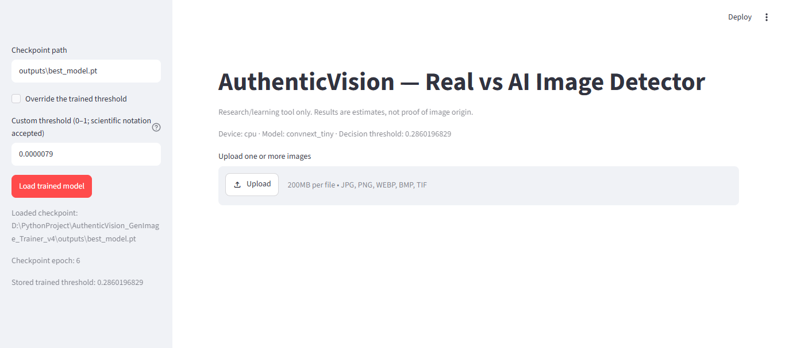

# AuthenticVision AI — Real vs AI-Generated Image Detector

An experimental deep-learning application that classifies images as **real** or **AI-generated** using a fine-tuned ConvNeXt-Tiny model. Built with PyTorch and Streamlit, AuthenticVision AI provides a simple interface for image prediction, command-line inference, and model evaluation.

<p align="center">
  <strong>AI Image Classification · Deep Learning · Computer Vision · PyTorch · Streamlit</strong>
</p>

---

## Overview

AI-generated images are becoming increasingly realistic, making it difficult to distinguish synthetic images from authentic photographs through visual inspection alone.

**AuthenticVision AI** explores this problem using transfer learning and image classification. It uses a pretrained ConvNeXt-Tiny architecture, fine-tuned on a real-versus-AI image dataset, to estimate whether an input image belongs to either category.

The project includes:

- A Streamlit interface for uploading and analyzing images.
- A trained ConvNeXt-Tiny image classification model.
- Command-line image prediction.
- Dataset preparation and training utilities.
- Evaluation tools for independent labelled datasets.
- A Google Colab notebook for cloud-based GPU training.
- Tests for selected metrics and data-splitting functionality.

> **Important:** This is an experimental image classifier, not a certified forensic detection system. Its predictions are estimates and should not be treated as proof that an image is authentic or AI-generated.

## Features

| Feature | Description |
|---|---|
| Image classification | Predicts real or AI-generated images |
| Deep learning | Uses a fine-tuned ConvNeXt-Tiny architecture |
| Transfer learning | Starts from pretrained ImageNet weights |
| Interactive interface | Streamlit-based image upload and prediction |
| Confidence scores | Displays model prediction scores |
| Threshold configuration | Supports configurable classification thresholds |
| CLI prediction | Analyze images through the command line |
| Model evaluation | Evaluate predictions on labelled image folders |
| GPU training | Supports cloud GPU training through Google Colab |
| CPU inference | Supports local inference on compatible Windows systems |

## Technology Stack

- **Programming language:** Python
- **Deep learning:** PyTorch
- **Computer vision:** Torchvision, PIL
- **Model architecture:** ConvNeXt-Tiny
- **Web interface:** Streamlit
- **Data processing:** NumPy, Pandas
- **Dataset access:** Hugging Face Datasets
- **Development and experimentation:** Google Colab, VS Code / PyCharm
- **Testing:** Pytest

## Model Architecture

AuthenticVision AI uses **ConvNeXt-Tiny**, a modern convolutional neural network architecture.

The model starts with pretrained ImageNet weights and is adapted through transfer learning for binary image classification.

**Classification labels:**

| Class index | Label |
|---|---|
| 0 | Real |
| 1 | AI-generated |

**Default image input size:** 224 × 224 pixels.

The model produces class scores that are used by the prediction pipeline to determine the final classification. The project also includes threshold-related logic to support configurable decision-making.

## Dataset

The project uses the following dataset:

**Dataset:** [TheKernel01/Tiny-GenImage](https://huggingface.co/datasets/TheKernel01/Tiny-GenImage)

Tiny-GenImage is used as a dataset source for real and AI-generated image classification experiments.

### Dataset and splitting considerations

The project includes generator-aware data-splitting functionality.

Two different evaluation scenarios should be distinguished:

1. **Image-disjoint evaluation:** Training and test images are separated, but images from the same generator families may occur in both sets.
2. **Unseen-generator evaluation:** A generator family is excluded from training and reserved for testing, allowing experiments on generalization to an unseen generator.

The training utility supports a `--holdout-generator` option for leave-one-generator-out experiments.

The default `--holdout-generator all` setting is intended for the project's standard deployment-training workflow. It should not be interpreted as proof of generalization to unseen generator families.

## Project Structure

```text
AuthenticVision_AI/
│
├── app.py
├── av_model.py
├── train.py
├── predict.py
├── evaluate_folder.py
├── hf_tiny_data.py
├── metrics_utils.py
│
├── notebooks/
│   └── AuthenticVision_Cloud_GPU_Training.ipynb
│
├── scripts/
│   └── ...
│
├── tests/
│   └── ...
│
├── reports/
│   └── research_notes.md
│
├── docs/
│   └── images/
│       ├── app-interface.png
│       ├── real-image-prediction.png
│       ├── ai-image-prediction.png
│       └── evaluation-results.png
│
├── requirements.txt
├── requirements-colab.txt
├── .gitignore
├── LICENSE.txt
└── README.md
```

**Note:** The trained model checkpoint is not included in the Git repository because of its file size. You must obtain or train a checkpoint before running predictions.

## Getting Started

### 1. Clone the repository

```bash
git clone https://github.com/AnasDev23/authenticvision-ai.git
```

Navigate to the project directory:

```bash
cd authenticvision-ai
```

### 2. Create a virtual environment

```bash
python -m venv .venv
```

Activate it on Windows PowerShell:

```powershell
.\.venv\Scripts\Activate.ps1
```

If PowerShell blocks activation, you can use Command Prompt:

```cmd
.venv\Scripts\activate.bat
```

### 3. Install dependencies

```bash
python -m pip install --upgrade pip
pip install -r requirements.txt
```

### 4. Prepare the model checkpoint

The trained model checkpoint is excluded from this repository because it exceeds GitHub's standard file-size limit.

Place your compatible checkpoint at:

```text
outputs/best_model.pt
```

Create the `outputs` folder if it does not already exist.

**Important:** Use a checkpoint trained with this project's model architecture and compatible with its inference code.

## Running the Application

Once the dependencies and compatible checkpoint are available, launch the Streamlit application:

```bash
streamlit run app.py
```

Open the local URL displayed in your terminal.

Upload an image through the interface to receive a classification prediction.

## Command-Line Prediction

The project also includes a command-line prediction utility.

Example:

```bash
python predict.py --help
```

Use the available arguments shown by the command to provide an image path and model checkpoint.

## Model Training

The project includes a training pipeline based on the Tiny-GenImage dataset.

For available training options:

```bash
python train.py --help
```

The training script supports configuration options such as:

- Dataset selection.
- Output directory.
- Number of epochs.
- Batch size.
- Image size.
- Learning rates.
- Sample limits.
- Generator holdout configuration.
- Target false-positive rate.
- Random seed.
- Resume training.
- CPU training mode.

For GPU-based training, use the included Google Colab notebook:

```text
notebooks/AuthenticVision_Cloud_GPU_Training.ipynb
```

It provides a cloud-based training workflow without requiring a dedicated local GPU.

## Model Evaluation

AuthenticVision AI includes an evaluation utility for testing trained checkpoints against independent, labelled image datasets.

Prepare an evaluation dataset using this folder structure:

```text
evaluation_data/
│
├── real/
│   ├── image1.jpg
│   ├── image2.jpg
│   └── ...
│
└── ai/
    ├── image1.jpg
    ├── image2.jpg
    └── ...
```

Run the evaluation utility:

```bash
python evaluate_folder.py --help
```

Example evaluation command:

```bash
python evaluate_folder.py --checkpoint ".\outputs\best_model.pt" --data-dir ".\evaluation_data" --output ".\reports\external_evaluation" --batch-size 16
```

The evaluation utility supports:

- Real versus AI-generated image evaluation.
- Configurable classification thresholds.
- Batch processing.
- Metrics generation.
- Prediction report export.

**Evaluation status:** Independently verified external benchmark results have not yet been published in this repository. Model performance should be assessed using a separate, representative test dataset. Training or validation results should not be presented as independent test performance.

## Screenshots

The following screenshots can be added to showcase the application and its functionality.

### Application Interface



### Real Image Prediction


### AI-Generated Image Prediction


### Evaluation Results


*If a screenshot is not available yet, add the corresponding image to `docs/images/` before publishing the README.*

## Testing

The project includes automated tests for selected functionality, including metrics calculations and data-splitting behavior.

Run the test suite using:

```bash
pytest
```

## Limitations and Responsible Use

AI-generated image detection is an evolving research area. No image classifier can guarantee perfect detection across all image sources and generation methods.

Known limitations include:

- New image generators may produce patterns not represented in the training data.
- Image resizing, compression, editing, and post-processing may affect predictions.
- Performance on unseen generator families may differ from performance on familiar generators.
- A high confidence score does not establish that a prediction is correct.
- Dataset composition and evaluation methodology can influence reported results.

**Responsible use:**

- Do not use predictions as definitive evidence of image authenticity.
- Do not rely on the model for legal, financial, employment, or other high-impact decisions.
- Verify important findings using independent evidence and appropriate expert review.

## Future Improvements

Potential future development includes:

- Evaluation on more independent image datasets.
- More extensive unseen-generator generalization experiments.
- Testing against additional AI image-generation models.
- Robustness testing under image compression and editing.
- Improved model calibration and threshold analysis.
- Additional visualization and explainability features.
- Further optimization for faster inference.

## License

The project's source code is distributed under the MIT License. See [LICENSE.txt](LICENSE.txt) for details.

**Dataset and pretrained-weight licensing:** The source-code license does not automatically apply to third-party datasets, source images, pretrained model weights, or other external resources. Review the applicable terms before redistribution or commercial use. The referenced Tiny-GenImage dataset identifies its licensing terms on its Hugging Face dataset page.

## Author

**Anas Islam**

BS Information Technology | Data & Business Intelligence | AI & Machine Learning | Software Development

- **GitHub:** [AnasDev23](https://github.com/AnasDev23)
- **LinkedIn:** [Anas Islam](https://www.linkedin.com/in/anas-islam-it/)
- **Email:** [anasislam.it@gmail.com](mailto:anasislam.it@gmail.com)

---

<p align="center">
  Built as an AI and computer vision learning project.
  <br>
  <strong>AuthenticVision AI — Exploring Real vs AI-Generated Image Detection</strong>
</p>
