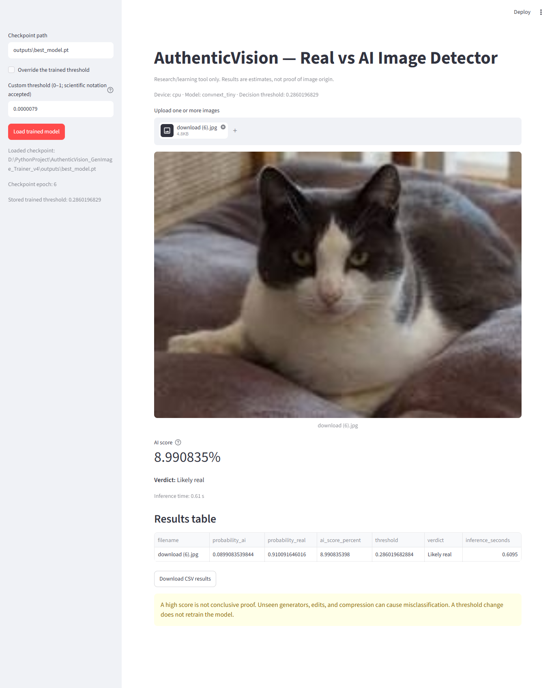
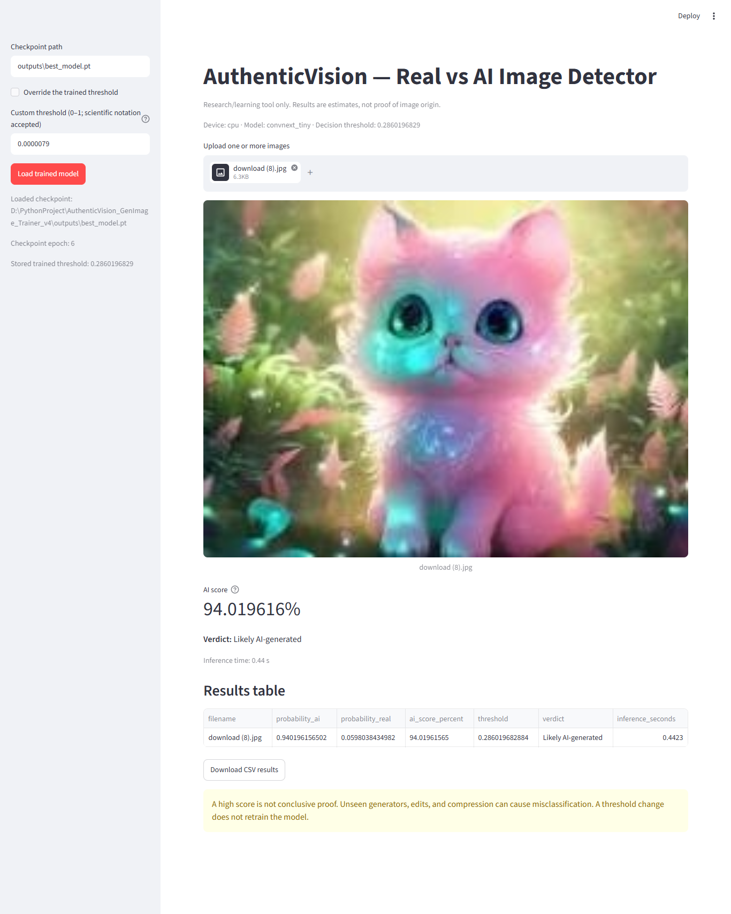
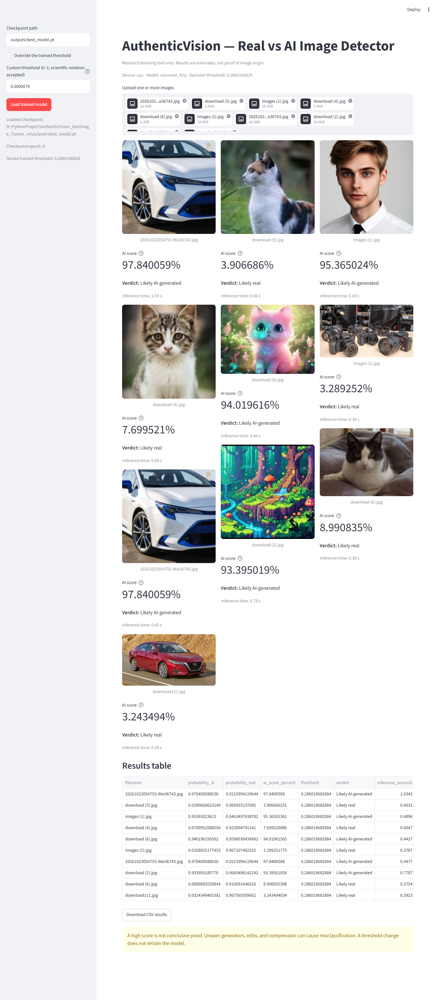

# AuthenticVision AI
### Real vs. AI-Generated Image Detection with ConvNeXt-Tiny

AuthenticVision AI is a machine-learning research and learning project that fine-tunes an ImageNet-pretrained **ConvNeXt-Tiny** image classifier to estimate whether an image is **real** or **AI-generated**. It includes a Google Colab training workflow, a local Streamlit interface, command-line inference, and evaluation utilities.

> **Important:** This is an experimental classifier, not forensic proof of an image's origin. Its predictions can be wrong—especially for images from unfamiliar generators, edited images, or images that differ from its training data.

---

## Project at a Glance

| | |
|---|---|
| Task | Binary image classification: real vs. AI-generated |
| Model | ConvNeXt-Tiny (`torchvision`) |
| Learning approach | Transfer learning / fine-tuning |
| Dataset | [TheKernel01/Tiny-GenImage](https://huggingface.co/datasets/TheKernel01/Tiny-GenImage) |
| Input size | 224 × 224 pixels (default training configuration) |
| Interface | Streamlit |
| Training environment | Google Colab GPU (recommended) |
| Local inference | Windows; CPU or CUDA when available |
| Project status | Research / learning project |

## Screenshots


### Application


### Prediction — Real Image



### Prediction — AI-Generated Image



### Predictions - multiple images




---

## Features

- Fine-tunes a pretrained ConvNeXt-Tiny model for two classes: `real` and `ai`.
- Uses generator-aware data splitting for deployment training and optional leave-one-generator-out research experiments.
- Calibrates a decision threshold from validation real-image scores to target a selected empirical false-positive rate.
- Provides a local Streamlit UI for single or multiple image uploads.
- Displays the AI score, verdict, and inference time.
- Exports batch prediction results to CSV.
- Includes command-line prediction and external-folder evaluation tools.
- Saves training checkpoints, metrics, prediction reports, and evaluation plots.
- Includes unit tests for metric calculations and data-split behavior.

## How It Works

1. Load the Tiny-GenImage dataset from Hugging Face.
2. Prepare real and AI-generated image subsets.
3. Fine-tune ConvNeXt-Tiny, replacing its final classifier layer with a two-class output.
4. Select the best checkpoint using validation ROC-AUC.
5. Calibrate the decision threshold using validation data—not the final test split.
6. Evaluate on a separate image-disjoint test subset.
7. Use the trained checkpoint locally through Streamlit or the command line.

### Model and preprocessing

The project uses `torchvision`'s ImageNet-pretrained ConvNeXt-Tiny weights as its starting point. The final classification layer is replaced with a two-output linear layer.

Training preprocessing includes random resized cropping, horizontal flipping, light color augmentation, and optional JPEG compression simulation. Evaluation preprocessing uses resize, center crop, and ImageNet normalization.

The model's output is converted to class probabilities with softmax. Class index `0` represents **real** and class index `1` represents **AI-generated**.

## Dataset and Evaluation Protocol

The default dataset is [TheKernel01/Tiny-GenImage](https://huggingface.co/datasets/TheKernel01/Tiny-GenImage), a curated subset in the GenImage family. The dataset card reports 35,000 rows (28,000 training and 7,000 validation) and an approximate total size of 8.36 GB. Dataset contents and availability may change; consult the dataset card before use.

### Deployment training (default)

The default configuration uses `--holdout-generator all`, which includes generator families present in the dataset's training split. Validation and test samples are separate images drawn from the official validation split.

**This is image-disjoint evaluation, not an unseen-generator test.** The generator families in the test set may also be represented during training.

### Leave-one-generator-out research mode

Training can exclude one generator family and use that family in a research test. This is useful for exploring cross-generator generalization. A checkpoint trained in this mode should not be treated as the recommended general-purpose deployment model when the excluded generator is relevant to expected user images.

### Performance reporting

Do not interpret a few sample predictions as evidence of model accuracy. For a meaningful report, evaluate on a labelled, independent dataset representative of the intended use and report metrics such as:

- Accuracy
- Precision and recall for the AI class
- F1-score
- ROC-AUC
- False-positive rate on real images
- False-negative rate on AI images
- Test sample counts and the evaluation protocol

**Project-specific benchmark results:** Add values from the final run's `metrics.json` here after checking the evaluation split and sample counts. This README intentionally does not claim an accuracy or ROC-AUC value that has not been verified.

| Metric | Final test result |
|---|---:|
| Test samples | Add from `metrics.json` |
| Accuracy | Add from `metrics.json` |
| AI precision | Add from `metrics.json` |
| AI recall | Add from `metrics.json` |
| AI F1-score | Add from `metrics.json` |
| ROC-AUC | Add from `metrics.json` |
| Real-image false-positive rate | Add from `metrics.json` |

---

## Installation and Local Usage

### Requirements

- Windows 10/11, 64-bit
- Python 3.11 or 3.12 recommended
- Git
- A trained `best_model.pt` checkpoint
- Internet connection for installing dependencies

Local CPU inference is supported. Training is resource-intensive; a cloud GPU such as an available Google Colab GPU is recommended.

### 1. Clone the repository

```powershell
git clone https://github.com/AnasDev23/authenticvision-ai.git
cd authenticvision-ai
```

If you have not published the repository yet, replace the URL with your repository URL.

### 2. Set up the local environment

Run the included Windows setup script:

```powershell
.\scripts\setup_windows.bat
```

The script creates a virtual environment, installs CPU builds of PyTorch and torchvision, and installs the local UI dependencies.

### 3. Add the trained checkpoint

Place your trained checkpoint here:

```text
outputs/best_model.pt
```

The model checkpoint is not included in the source repository by default because model weights are large and may have separate distribution considerations. See [Model Checkpoint](#model-checkpoint).

### 4. Launch the application

```powershell
.\scripts\run_app_windows.bat
```

Streamlit will start the local application. Open the local URL printed in the terminal, usually `http://localhost:8501`.

In the sidebar, load the checkpoint and upload one or more images. The interface displays an estimated AI score and a verdict, and lets you download prediction results as CSV.

---

## Command-Line Prediction

Run a prediction for one image:

```powershell
python predict.py --checkpoint outputs/best_model.pt --image "D:\photos\sample.jpg"
```

Optional threshold override:

```powershell
python predict.py --checkpoint outputs/best_model.pt --image "D:\photos\sample.jpg" --threshold 0.5
```

Normally, leave the threshold unset to use the value stored in the checkpoint. A threshold changes the decision rule; it does **not** retrain or improve the model.

## Evaluate an External Dataset

Prepare a labelled folder with this layout:

```text
evaluation_data/
├── real/
│   ├── real_001.jpg
│   └── ...
└── ai/
    ├── ai_001.jpg
    └── ...
```

Then run:

```powershell
python evaluate_folder.py --checkpoint outputs/best_model.pt --data-dir evaluation_data --output external_evaluation
```

The script writes `metrics.json` and `predictions.csv` to the output directory. Use an independent labelled dataset for external evaluation; do not tune a threshold on the same test data used for final reporting.

## Training in Google Colab

The repository includes a notebook:

`notebooks/AuthenticVision_Cloud_GPU_Training.ipynb`

Recommended workflow:

1. Upload the notebook to [Google Colab](https://colab.research.google.com/).
2. Select an available GPU runtime.
3. Run the notebook cells in order and upload the project ZIP when prompted.
4. Keep `HOLDOUT_GENERATOR = 'all'` for the default deployment training mode.
5. Review the generated `metrics.json`, training history, and plots.
6. Download the results archive and copy the final `best_model.pt` into the local project's `outputs/` directory.

The notebook's default settings include up to 8 epochs, batch size 16, image size 224, up to 2,000 AI training images per generator, a `1e-5` backbone learning rate, and a `1e-4` classifier-head learning rate. These are configuration defaults, not a guarantee of a particular score. Cloud GPU availability and limits can vary.

For a research experiment that excludes a specific generator, set `HOLDOUT_GENERATOR` to a supported generator name and use a separate output directory. Review the notebook and training script before running a long experiment.

## Tests

Run the included unit tests from the repository root:

```powershell
python -m unittest discover -s tests -v
```

These tests cover metric calculations and data-split behavior. They do not train the model or prove real-world detection performance.

## Repository Structure

```text
authenticvision-ai/
├── app.py                         # Streamlit application
├── av_model.py                    # ConvNeXt-Tiny, transforms, checkpoint loading
├── train.py                       # Training and evaluation pipeline
├── predict.py                     # Single-image CLI prediction
├── evaluate_folder.py              # Evaluation on a labelled image folder
├── diagnose_prediction.py          # Detailed prediction diagnostics
├── hf_tiny_data.py                # Dataset loading and split construction
├── metrics_utils.py                # Metrics and threshold calibration
├── requirements.txt
├── requirements-local.txt
├── requirements-cloud.txt
├── notebooks/
│   └── AuthenticVision_Cloud_GPU_Training.ipynb
├── scripts/
│   ├── setup_windows.bat
│   ├── run_app_windows.bat
│   └── check_environment.py
├── tests/
├── reports/
│   └── research_notes.md
├── docs/
│   └── images/                    # README screenshots
└── outputs/                       # Local model files; excluded from Git by default
```


## Limitations and Responsible Use

- AI image generators evolve; performance on current or unseen generators is not guaranteed.
- Resizing, compression, editing, screenshots, and post-processing can change predictions.
- A model score is a probability-like estimate from this classifier, not a verified probability of provenance.
- A false positive may incorrectly label a real photograph as AI-generated; a false negative may miss an AI-generated image.
- Do not use this project as the sole basis for high-impact decisions, accusations, or authenticity claims.
- Test independently on images and generators relevant to your intended use.

## Dataset License and Project License

The project's code is distributed under the MIT License in `LICENSE.txt`.

The Tiny-GenImage dataset card lists **CC-BY-NC-SA-4.0**. The code license does not change the dataset license or the terms of any source images, pretrained weights, or other third-party assets. Check the current dataset terms and applicable permissions before redistributing dataset-derived assets, model weights, or using them commercially.

- Dataset: [TheKernel01/Tiny-GenImage](https://huggingface.co/datasets/TheKernel01/Tiny-GenImage)
- Original GenImage benchmark: [GenImage-Dataset/GenImage](https://github.com/GenImage-Dataset/GenImage)
- Pretrained model family: [Torchvision ConvNeXt-Tiny](https://pytorch.org/vision/stable/models/convnext.html)

---

## Acknowledgements

- The Tiny-GenImage dataset authors and contributors
- The GenImage benchmark project
- PyTorch and Torchvision
- Hugging Face Datasets
- Streamlit

## Author

**Anas Islam**  
[GitHub](https://github.com/AnasDev23) · [LinkedIn](https://www.linkedin.com/in/anas-islam-it/)

---

*Built as a machine-learning learning and research project. Predictions are experimental and should be independently validated.*
